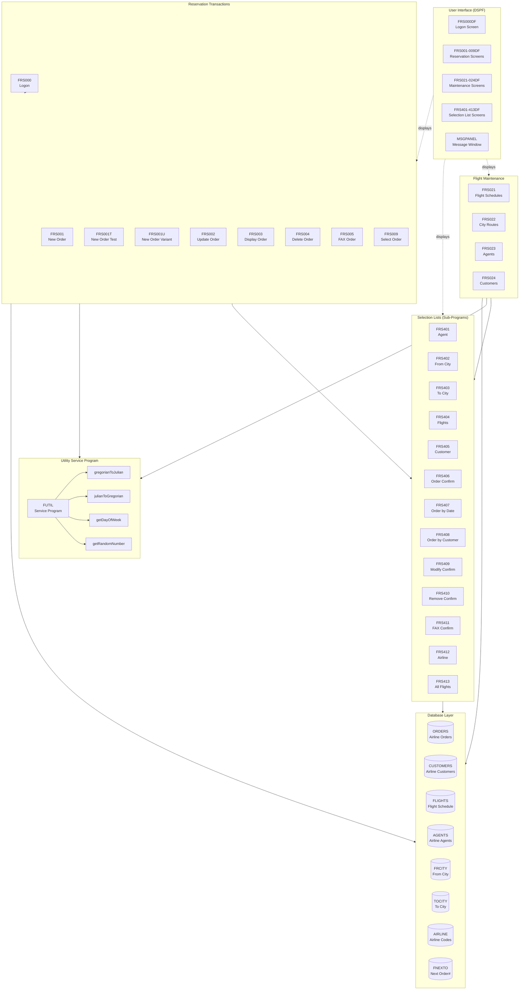
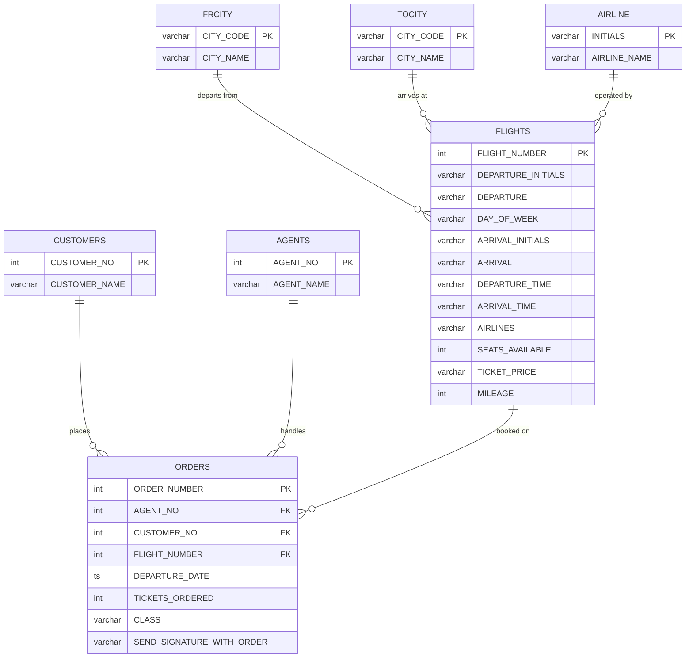
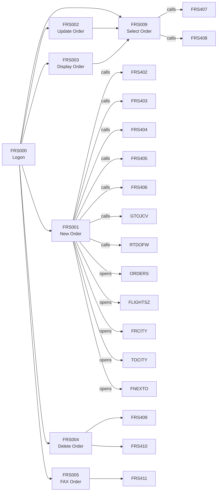
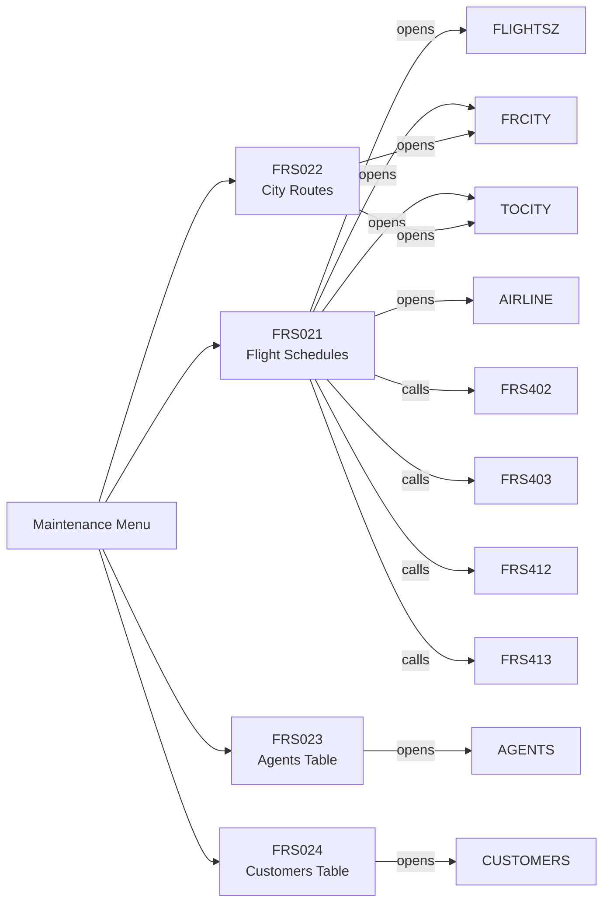
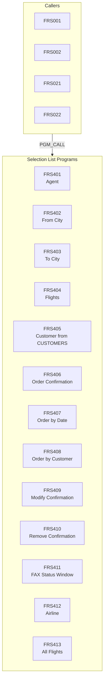
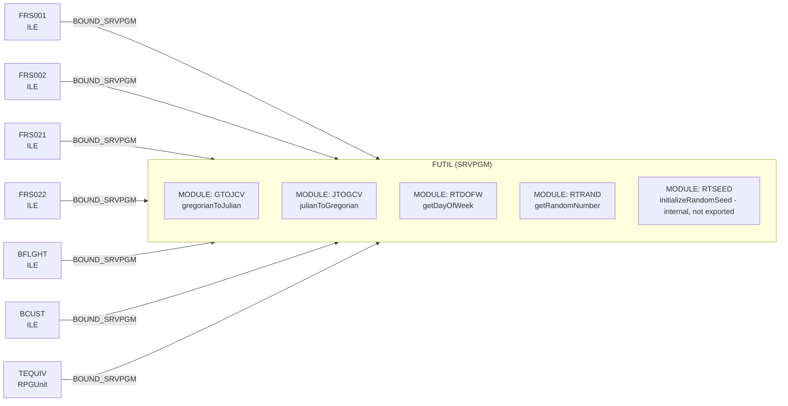
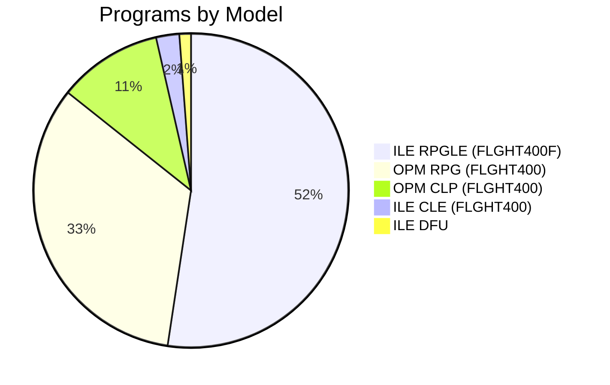

# Flight 400 — Application Architecture

> Generated from Understand scan dated **2026-10-20**  
> Libraries: `FLGHT400F` (ILE modernised), `FLGHT400` (OPM legacy)  
> Total objects scanned: **191**

---

## 1. Application Overview

**Flight 400** is an interactive IBM i reservation system for a fictitious airline.  
It provides end-to-end management of the airline's operations through five functional components:

| Component | Programs | Purpose |
|---|---|---|
| **Reservation Transactions** | FRS000–FRS011 | Customer-facing order lifecycle (create, modify, display, delete, fax) |
| **Flight Maintenance** | FRS021–FRS024 | Back-office management of flight schedules, city routes, agents and customers |
| **Selection Lists** | FRS401–FRS413 | Reusable sub-program windows (LOV pop-ups) called by transactions and maintenance |
| **Utility Service Program** | FUTIL | Shared date-conversion and random-number procedures via ILE service program |
| **Data Population Build** | BFLGHT, BCUST | One-shot programs to seed FLIGHTS and CUSTOMERS tables |

The application is in a **mixed OPM/ILE** state.  
The legacy OPM objects reside in `FLGHT400`; the modern ILE rewrites live in `FLGHT400F`.

---

## 2. High-Level Architecture

---

## 3. Data Model

### 3.1 Core Physical Files

| File | Description | Key Columns | Inbound Deps |
|---|---|---|---|
| `CUSTOMERS` | Airline Customers | CUSTOMER_NO, CUSTOMER_NAME | 12 |
| `FRCITY` | From-City route table | — | 10 |
| `ORDERS` | Airline Orders | ORDER_NUMBER, AGENT_NO, CUSTOMER_NO, FLIGHT_NUMBER, DEPARTURE_DATE, TICKETS_ORDERED, CLASS | 10 |
| `TOCITY` | To-City route table | — | 10 |
| `FLIGHTS` | Flight schedule | FLIGHT_NUMBER, DEPARTURE_INITIALS, DEPARTURE, DAY_OF_WEEK, ARRIVAL_INITIALS, ARRIVAL, DEPARTURE_TIME, ARRIVAL_TIME, AIRLINES, SEATS_AVAILABLE, TICKET_PRICE, MILEAGE | 5 |
| `AGENTS` | Airline Agents | AGENT_NO, AGENT_NAME | 5 |
| `AIRLINE` | Airline codes for validation | — | 4 |
| `FNEXTO` | Next order number sequence | — | 3 |
| `FNAME` | First-name table (build only) | — | 1 |
| `LNAME` | Last-name table (build only) | — | 1 |

### 3.2 Entity-Relationship Diagram

> **36 cascade-delete FK constraints** are defined in FLGHT400. All 30 physical files are journaled (19 through `QSQJRN`; remainder may journal externally).

### 3.3 Logical Files and Views

| Logical File | Base PF | Purpose |
|---|---|---|
| `CUSTOMER` | CUSTOMERS | By descending customer number |
| `CUSTNAME` | CUSTOMERS | By customer name |
| `CUSTOMRZ` | CUSTOMERS | Binary-to-zoned conversion |
| `CUSTORD` | CUSTOMERS + ORDERS | Join by customer name |
| `ORDDATE` | ORDERS + CUSTOMERS | Join by date |
| `ORDNAME` | ORDERS + CUSTOMERS | Join by order number |
| `ORDERSZ` | ORDERS | Binary-to-zoned conversion |
| `FLIGHTSZ` | FLIGHTS | Binary-to-zoned (most used LF, 9 deps) |
| `FLIGHTSL` | FLIGHTS | By From City / To City / Day of Week |
| `AGENTSL` | AGENTS | By agent name |
| `AGENTSZ` | AGENTS | Binary-to-zoned conversion |
| `AIRLINEL` | AIRLINE | By airline initials |
| `FRCITYL` | FRCITY | City lookup |
| `TOCITYL` | TOCITY | City lookup |

---

## 4. Functional Components

### 4.1 Reservation Transactions

These programs implement the full order lifecycle. They are the most coupled objects in the application (15 outbound dependencies each).

| Program | ILE (FLGHT400F) | OPM (FLGHT400) | Description |
|---|---|---|---|
| FRS000 | FRS000 | FRS000 | Flight Reservation System Logon |
| FRS001 | FRS001, FRS001T, FRS001U, FRS001U2 | FRS001, FRS001T, FRS001U | New Order — multiple variants and teaching versions |
| FRS002 | FRS002 | FRS002 | Update Order |
| FRS003 | FRS003 | FRS003 | Display Order |
| FRS004 | FRS004 | FRS004 | Delete Order |
| FRS005 | FRS005 | FRS005 | FAX Order |
| FRS009 | FRS009 | FRS009, FRS010 | Select Order (FRS010 is alternate OPM version) |

### 4.2 Flight Maintenance

Back-office programs for managing reference data. All are no-inbound-dependency entry points (called from the maintenance menu).

| Program | ILE | OPM | Description |
|---|---|---|---|
| FRS021 | FRS021 | FRS021 | Flight Maintenance - Flight Schedules |
| FRS022 | FRS022 | FRS022 | Flight Maintenance - City Routes |
| FRS023 | FRS023 | FRS023 | Flight Maintenance - Agents Table |
| FRS024 | FRS024 | FRS024 | Flight Maintenance - Customers Table |

### 4.3 Selection Lists (Sub-Programs)

Reusable LOV (list-of-values) windows called by both Reservation Transactions and Flight Maintenance. They are the **most depended-upon programs** (up to 7 inbound deps).

| Program | Inbound Deps | Opens |
|---|---|---|
| FRS402 | 7 | FRCITY |
| FRS403 | 6 | TOCITY |
| FRS405 | 6 | CUSTOMERS |
| FRS404 | 5 | FLIGHTSL |
| FRS406 | 4 | — (display only) |
| FRS401 | 4 | AGENTS |
| FRS407 | 2 | ORDERS (by date) |
| FRS408 | 2 | ORDERS (by customer) |
| FRS412 | 2 | AIRLINE |
| FRS413 | 1 | FLIGHTS |

### 4.4 Utility Service Program (FUTIL)

`FUTIL` is an ILE service program bound by **7 programs** (all in `FLGHT400F`). It exports five procedures implemented as separate modules:

### 4.5 Data Population Build Programs

One-shot programs for seeding test/demo data. No inbound dependencies — called directly or via `BLDCST` CL wrapper.

| Program | Description |
|---|---|
| BFLGHT | Builds FLIGHTS / FRCITY / TOCITY / AIRLINE test data |
| BCUST | Builds CUSTOMERS test data using FNAME / LNAME tables |
| BLDCST | CL wrapper — calls BCUST |

---

## 5. ILE vs OPM Inventory

| Model | Count | Libraries | Notes |
|---|---|---|---|
| ILE RPGLE | 44 | FLGHT400F | Modern rewrites; target state |
| OPM RPG | 28 | FLGHT400 | Legacy; candidates for retirement once ILE equivalents verified |
| OPM CLP | 9 | FLGHT400 | Short CL wrappers and build utilities |
| ILE CLE | 2 | FLGHT400 | Understand scanner procedures (SCAN_LIB, SCAN_APP) |
| ILE DFU | 1 | FLGHT400 | AGENTDFU — interactive data file utility |

---

## 6. RPGUnit Test Suites

Five RPGUnit test service programs exist in `FLGHT400F` / `QTESTSRC`:

| Suite | Tests |
|---|---|
| TEQUIV | Master equivalence suite (compares OPM vs ILE results for all four utilities) |
| TGTOJCV | GTOJCV unit tests |
| TJTOGCV | JTOGCV unit tests |
| TRTDOFW | RTDOFW unit tests |
| TRTRAND | RTRAND unit tests |
| TRTSEED | initializeRandomSeed unit tests (binds the RTSEED module directly, `tests/rtseed/`) |

---

## 7. Source Physical File Partitioning

All ILE source resides in `FLGHT400F`. The partitioning aligns each source physical file with a functional component.

```mermaid
flowchart TD
    subgraph FLGHT400F["Library: FLGHT400F"]
        direction TB
        QDDSSRCF_box["QDDSSRCF\nDatabase File DDS\nPhysical & Logical files"]
        QDDSSRC_box["QDDSSRC\nDisplay File DDS\nAll DSPF screens"]
        QMNUSRC_box["QMNUSRC\nMenus and Navigation\nFRSMAIN / FRSMANT / FRSREPT"]
        QRESVRSRC_box["QRESVRSRC\nReservation Transactions\nFRS000-FRS009 RPGLE"]
        QMNTSRC_box["QMNTSRC\nFlight Maintenance\nFRS021-FRS024 RPGLE"]
        QSELSRC_box["QSELSRC\nSelection List Sub-Programs\nFRS401-FRS413 RPGLE"]
        QUTILSRC_box["QUTILSRC\nUtility Service Program\nGTOJCV JTOGCV RTDOFW RTRAND RTSEED modules"]
        QSRVSRC_box["QSRVSRC\nBinder Language\nFUTIL binder source"]
        QBUILDSRC_box["QBUILDSRC\nData Population Build Programs\nBFLGHT BCUST RPGLE + BLDCST CLP"]
        QCLPSRC_box["QCLPSRC\nCL Programs and CMD Source\nFRS001CL FRS411CL etc."]
        QTESTSRC_box["QTESTSRC\nRPGUnit Test Suites\nTEQUIV TGTOJCV TJTOGCV TRTDOFW TRTRAND TRTSEED"]
    end
```

### 7.0 Local Source Directory Mapping

| Source Physical File | Local Directory |
|---|---|
| QDDSSRCF | `database/` |
| QDDSSRC | `displays/` |
| QMNUSRC | `menus/` |
| QUTILSRC | `utilities/` |
| QSRVSRC | `utilities/` |
| QSELSRC | `selections/` |
| QRESVRSRC | `reservations/` |
| QMNTSRC | `maintenance/` |
| QBUILDSRC | `build/` |
| QCLPSRC | `clprograms/` |
| QTESTSRC | `tests/` |

### 7.1 Member Assignment Table

#### QDDSSRCF — Database File DDS

| Member | Type | Description |
|---|---|---|
| CUSTOMERS | PF | Airline Customers |
| ORDERS | PF | Airline Orders |
| FLIGHTS | PF | Flight Schedule |
| AGENTS | PF | Airline Agents |
| FRCITY | PF | From-City route table |
| TOCITY | PF | To-City route table |
| AIRLINE | PF | Airline codes |
| FNEXTO | PF | Next order number |
| FNAME | PF | First name build table |
| LNAME | PF | Last name build table |
| FCITY | PF | City table (alternate) |
| CUSTOMER | LF | Customers by descending number |
| CUSTNAME | LF | Customers by name |
| CUSTOMRZ | LF | Customers binary-to-zoned |
| CUSTORD | LF | Join: customers + orders by name |
| ORDDATE | LF | Join: orders + customers by date |
| ORDNAME | LF | Join: orders + customers by order# |
| ORDERSZ | LF | Orders binary-to-zoned |
| FLIGHTSZ | LF | Flights binary-to-zoned |
| FLIGHTSL | LF | Flights by from/to city/day |
| AGENTSL | LF | Agents by name |
| AGENTSZ | LF | Agents binary-to-zoned |
| AIRLINEL | LF | Airline by initials |
| FRCITYL | LF | From-city lookup |
| TOCITYL | LF | To-city lookup |

#### QDDSSRC — Display File DDS

| Member | Type | Description |
|---|---|---|
| FRS000DF | DSPF | Logon screen |
| FRS001DF | DSPF | New order entry |
| FRS002DF | DSPF | Update order |
| FRS003DF | DSPF | Display order |
| FRS004DF | DSPF | Delete order |
| FRS005DF | DSPF | FAX order |
| FRS009DF | DSPF | Select order |
| FRS021DF | DSPF | Flight schedules maintenance |
| FRS022DF | DSPF | City routes maintenance |
| FRS023DF | DSPF | Agents maintenance |
| FRS024DF | DSPF | Customers maintenance |
| FRS401DF | DSPF | Select agent |
| FRS402DF | DSPF | Select from-city |
| FRS403DF | DSPF | Select to-city |
| FRS404DF | DSPF | Select flight |
| FRS405DF | DSPF | Select customer |
| FRS406DF | DSPF | Order confirmation window |
| FRS407DF | DSPF | Select order by date |
| FRS408DF | DSPF | Select order by customer |
| FRS409DF | DSPF | Modify confirmation window |
| FRS410DF | DSPF | Remove confirmation window |
| FRS411DF | DSPF | FAX status window |
| FRS412DF | DSPF | Select airline |
| FRS413DF | DSPF | Select all flights |
| FRSMAIN | DSPF | Main menu |
| FRSMANT | DSPF | Maintenance menu |
| FRSREPT | DSPF | Reports menu |
| MSGPANEL | DSPF | Messaging / confirmation window |

#### QRESVRSRC — Reservation Transaction Programs

| Member | Type | Description |
|---|---|---|
| FRS000 | RPGLE | Logon / main dispatcher |
| FRS001 | RPGLE | New order (primary ILE version) |
| FRS001T | RPGLE | New order — teaching/trace variant |
| FRS001U | RPGLE | New order — update variant |
| FRS001U2 | RPGLE | New order — variant 2 |
| FRS001X | RPGLE | New order — experimental |
| FRS002 | RPGLE | Update order |
| FRS003 | RPGLE | Display order |
| FRS004 | RPGLE | Delete order |
| FRS005 | RPGLE | FAX order |
| FRS009 | RPGLE | Select order |
| PROTYPES | RPGLE | Shared procedure prototypes include |

#### QMNTSRC — Flight Maintenance Programs

| Member | Type | Description |
|---|---|---|
| FRS021 | RPGLE | Flight schedules |
| FRS022 | RPGLE | City routes |
| FRS023 | RPGLE | Agents table |
| FRS024 | RPGLE | Customers table |

#### QSELSRC — Selection List Sub-Programs

| Member | Type | Description |
|---|---|---|
| FRS401 | RPGLE | Select agent |
| FRS401B | RPGLE | Select agent — variant B |
| FRS402 | RPGLE | Select from-city |
| FRS402B | RPGLE | Select from-city — variant B |
| FRS403 | RPGLE | Select to-city |
| FRS404 | RPGLE | Select flights |
| FRS404B | RPGLE | Select flights — variant B |
| FRS405 | RPGLE | Select customer |
| FRS406 | RPGLE | Order confirmation window |
| FRS407 | RPGLE | Select order by date |
| FRS408 | RPGLE | Select order by customer |
| FRS409 | RPGLE | Modify confirmation window |
| FRS410 | RPGLE | Remove confirmation window |
| FRS411 | RPGLE | FAX status window |
| FRS412 | RPGLE | Select airline |
| FRS413 | RPGLE | Select all flights |

#### QUTILSRC — Utility Service Program Source (Modules)

| Member | Type | Description |
|---|---|---|
| GTOJCV | RPGLE | Module: gregorianToJulian |
| JTOGCV | RPGLE | Module: julianToGregorian |
| RTDOFW | RPGLE | Module: getDayOfWeek |
| RTRAND | RPGLE | Module: getRandomNumber |
| RTSEED | RPGLE | Module: initializeRandomSeed (internal to FUTIL, not exported in futil.bnd; called by RTRAND) |

#### QSRVSRC — Binder Language Source

| Member | Type | Description |
|---|---|---|
| FUTIL | BND | FUTIL service program binder source |

#### QBUILDSRC — Data Population Build Programs

| Member | Type | Description |
|---|---|---|
| BFLGHT | RPGLE | Build FLIGHTS / city / airline test data |
| BCUST | RPGLE | Build CUSTOMERS test data |

#### QCLPSRC — CL Programs and CMD Source

| Member | Type | Description |
|---|---|---|
| FRS001CL | CLLE | New order CL wrapper |
| FRS411CL | CLLE | FAX confirmation CL wrapper |
| BLDCST | CLLE | Build customers CL wrapper |
| MSGPGM2 | CLLE | Confirmation messages (variant 2) |
| MSGPRG | CLLE | Displays confirmation messages |
| MSGPRGH | CLLE | Displays confirmation messages (heading) |
| TESTIT | CLLE | Test utility |
| USECLEAR | CLLE | Demonstrates CLEAR opcode |
| USERESET | CLLE | Demonstrates RESET opcode |

#### QMNUSRC — Menus and Navigation

| Member | Type | Description |
|---|---|---|
| FRSMAIN | MNUDDS | Flight Reservation System main menu |
| FRSMAINQQ | MNUDDS | Main menu message file definitions |
| FRSMANT | MNUDDS | Maintenance sub-menu |
| FRSMANTQQ | MNUDDS | Maintenance menu message file definitions |
| FRSREPT | MNUDDS | Reports sub-menu |
| FRSREPTQQ | MNUDDS | Reports menu message file definitions |

#### QTESTSRC — RPGUnit Test Suites

| Member | Type | Description |
|---|---|---|
| TEQUIV | RPGLE | Master equivalence suite |
| TGTOJCV | RPGLE | GTOJCV unit tests |
| TJTOGCV | RPGLE | JTOGCV unit tests |
| TRTDOFW | RPGLE | RTDOFW unit tests |
| TRTRAND | RPGLE | RTRAND unit tests |
| TRTSEED | RPGLE | initializeRandomSeed unit tests (binds the RTSEED module directly, `tests/rtseed/`) |

---

## 8. OPM Legacy Objects (FLGHT400)

The following OPM objects in `FLGHT400` have corresponding ILE equivalents in `FLGHT400F`.  
They are **retirement candidates** once the ILE versions are verified through the RPGUnit equivalence tests.

| OPM Program | ILE Equivalent | Status |
|---|---|---|
| FRS000 (RPG) | FRS000 (RPGLE) | RPGUnit tests pending |
| FRS001 (RPG) | FRS001, FRS001T, FRS001U (RPGLE) | RPGUnit tests pending |
| FRS002 (RPG) | FRS002 (RPGLE) | RPGUnit tests pending |
| FRS003 (RPG) | FRS003 (RPGLE) | RPGUnit tests pending |
| FRS004 (RPG) | FRS004 (RPGLE) | RPGUnit tests pending |
| FRS005 (RPG) | FRS005 (RPGLE) | RPGUnit tests pending |
| FRS009 (RPG) | FRS009 (RPGLE) | RPGUnit tests pending |
| FRS021 (RPGLE in FLGHT400) | FRS021 (RPGLE in FLGHT400F) | ILE in both libs |
| FRS022 (RPG) | FRS022 (RPGLE) | RPGUnit tests pending |
| FRS023 (RPG) | FRS023 (RPGLE) | RPGUnit tests pending |
| FRS024 (RPG) | FRS024 (RPGLE) | RPGUnit tests pending |
| FRS401–FRS413 (RPG) | FRS401–FRS413 (RPGLE) | RPGUnit tests pending |
| GTOJCV (RPG) | GTOJCV (MODULE/RPGLE via FUTIL) | TGTOJCV suite green |
| JTOGCV (RPG) | JTOGCV (MODULE/RPGLE via FUTIL) | TJTOGCV suite green |
| RTDOFW (RPG) | RTDOFW (MODULE/RPGLE via FUTIL) | TRTDOFW suite green |
| RTRAND (RPG) | RTRAND (MODULE/RPGLE via FUTIL) | TRTRAND suite green |

---

## 9. Modernisation Signals

| Signal | Count | Notes |
|---|---|---|
| OPM programs | 37 | All in FLGHT400; see Section 8 |
| Programs without inbound deps | 39 | Includes menus, entry points — verify before deleting |
| Programs not used in 365 days | 75 | Most OPM programs show no usage; ILE equivalents active |
| Physical files without journal record | 12 | May journal externally; confirm before marking unjournaled |
| Dynamic SQL objects | 1 | SCAN_LIB (Understand infrastructure) — not app code |
| Adopted authority objects | 52 | Review per security hardening requirements |

---

*Document generated by Bob — IBM i Developer on 2026-10-20 from Understand app scan "Flight 400".*
