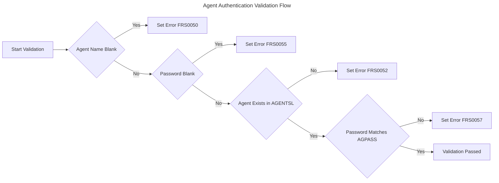
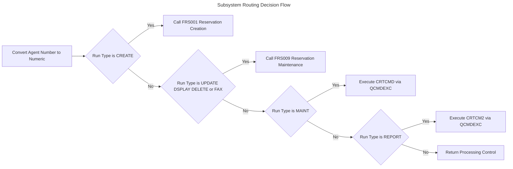
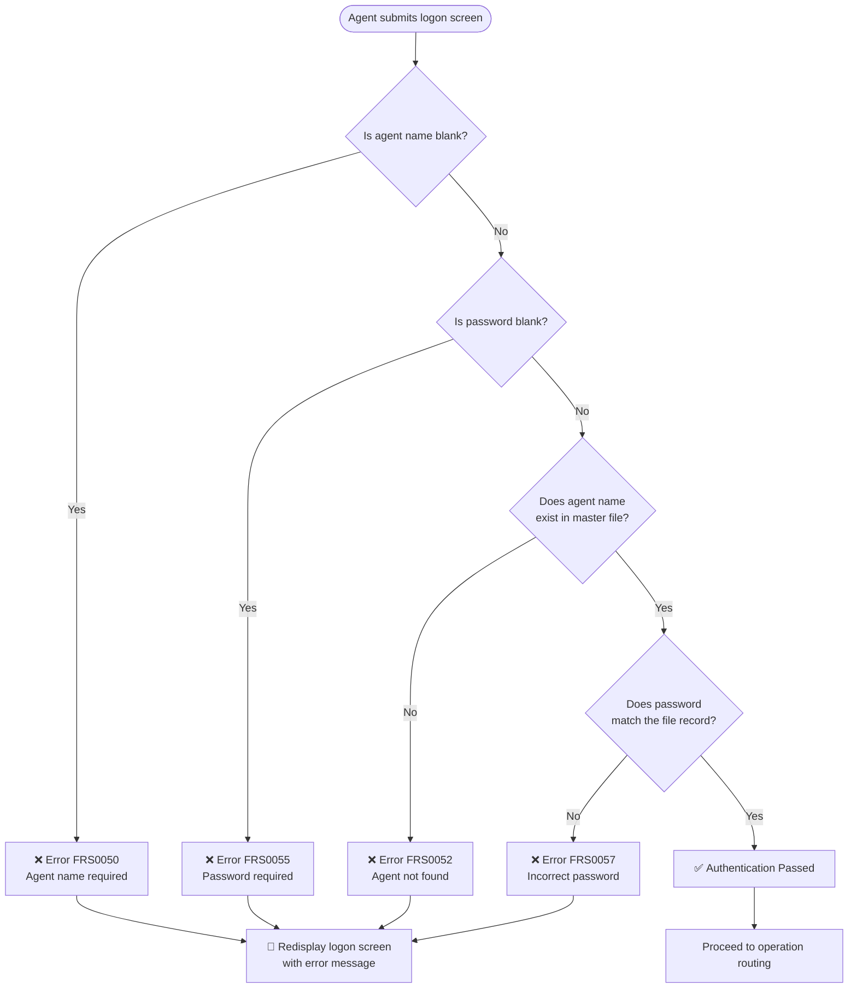
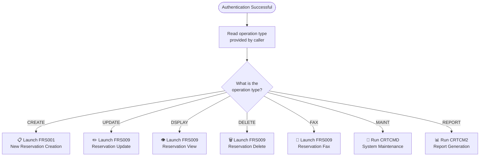
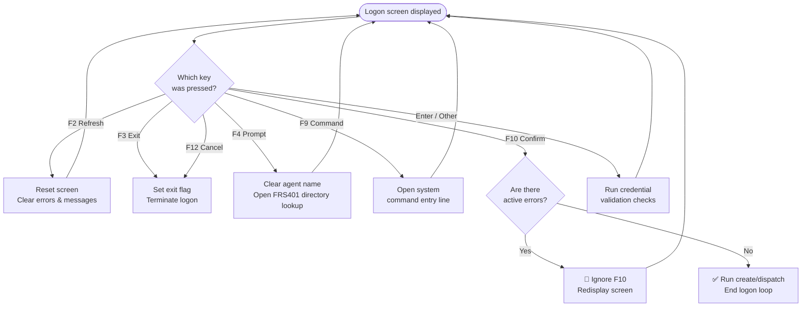
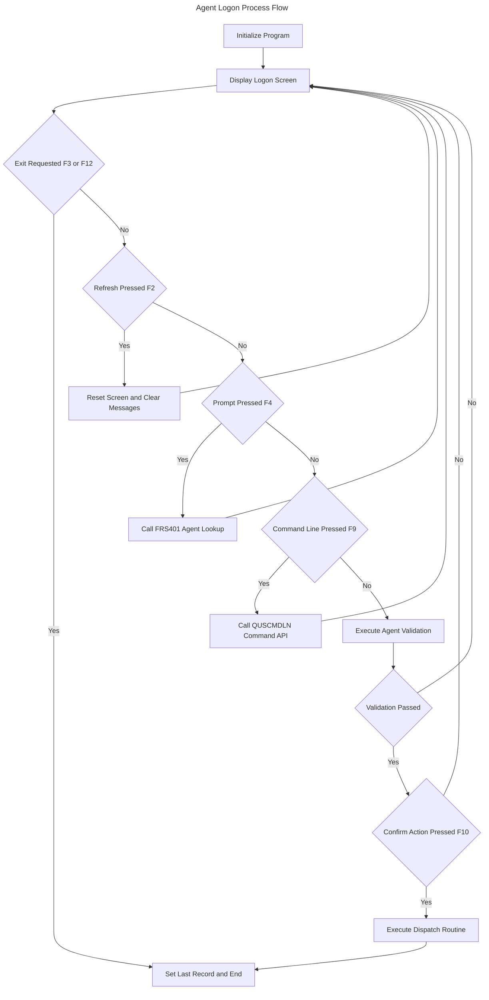

# FRS000 — Agent Logon & Reservation Dispatch

## Business Rules Report

---

# 1. Executive Summary

**FRS000** is the central gateway program for a **Flight Reservation System (FRS)**. Its primary business purpose is to authenticate airline agents before granting them access to any reservation or maintenance activity within the system. No agent may create, update, view, delete, or report on reservations without first successfully logging in through this program.

The program presents a logon screen where an agent enters their name and password. It validates those credentials against a master file of authorized airline agents. Once the agent is confirmed, the program determines what type of work has been requested — such as creating a new reservation, updating an existing one, running a report, or performing system maintenance — and routes the agent to the correct subsystem automatically.

FRS000 acts as the **single point of entry and security enforcement** for the entire reservation platform. It controls who can access the system, verifies their identity, and ensures they are directed to the right function. It is always called by another part of the system, which tells it in advance what operation the agent will be performing. This design means that every downstream reservation program is protected behind a consistent authentication checkpoint.

**Key Business Functions:**

- **Agent Authentication** — Validates agent name and password against the agents master file
- **Agent Lookup / Prompt** — Allows agents to search and select their name from a directory
- **Operation Routing** — Dispatches authenticated agents to the correct reservation or maintenance program
- **Session Control** — Manages screen refresh, exit, and cancellation throughout the logon dialog
- **Command Line Access** — Provides authorized access to a system command interface

---

# 2. Detailed Business Rules

## 🔐 Domain: Agent Authentication & Security

### Agent Credential Validation at Logon
**Category:** Validation
**Domain:** Customer

**Description:** Before any agent is granted access to the system, both their agent name and password must be provided and verified against the agents master file. The system checks that the name exists and that the password entered matches the one on record.

**Trigger Conditions:**
- The agent attempts to proceed past the logon screen (presses Enter or a confirmation key)
- Either the agent name or password field has been filled in

**Business Outcome:**
- If validation passes, the agent is authenticated and access proceeds
- If any check fails, an error message is displayed and the agent must correct their input

**Related Data:** `AGENTSL.AGNAME` (agent name), `AGENTSL.AGPASS` (agent password), `AGENTSL.AGNMBR` (agent number)

---

### Agent Lookup via Directory Prompt
**Category:** Business Process
**Domain:** Customer

**Description:** An agent who does not know or remember the exact spelling of their name can press the **F4 key** to open an agent directory lookup. The agent name field is cleared, and a separate selection program presents a searchable list of agents. The selected name is returned and populated on the logon screen automatically.

**Trigger Conditions:**
- The agent presses the **F4 (Prompt)** key on the logon screen

**Business Outcome:**
- The agent name field is cleared
- The agent selection program (**FRS401**) is launched
- The chosen agent name is returned and placed in the logon screen's name field

**Related Data:** Agent name field on the logon screen

---

### Command Line Access for Authorized Users
**Category:** Authorization
**Domain:** General

**Description:** A user may request access to the system's command entry interface by pressing **F9**. This provides a direct command line prompt, which is a privileged capability intended for administrative or technical users operating within an authenticated session.

**Trigger Conditions:**
- The user presses the **F9** key on the logon screen

**Business Outcome:**
- The system command entry interface is presented to the user

**Related Data:** System API `QUSCMDLN`

---

## 🔄 Domain: Session & Screen Control

### Logon Screen Navigation and Function Key Handling
**Category:** Business Process
**Domain:** General

**Description:** The logon screen operates as a continuous dialog loop. On each pass, the system first displays any pending messages, then shows the logon screen. The agent's choice of function key determines what action is taken next.

| Function Key | Business Action |
|---|---|
| **F2 – Refresh** | Resets the screen, clears errors, and allows re-entry |
| **F3 – Exit** | Exits the logon program entirely |
| **F4 – Prompt** | Opens the agent name lookup directory |
| **F9 – Command Line** | Opens the system command entry interface |
| **F10 – Confirm** | Submits credentials and proceeds (if validation passes) |
| **F12 – Cancel** | Cancels and exits the logon session |
| **Enter / Other** | Triggers validation of the entered data |

**Trigger Conditions:**
- The logon screen is actively displayed and the user presses any key

**Business Outcome:**
- The appropriate action for the pressed key is executed
- The loop continues until the agent exits, cancels, or successfully logs in

**Related Data:** `FRS000DF.LOGONR` (logon screen), `FRS000DF.MSGCTL` (message control area)

---

### Screen Refresh — Clear Errors and Reset Input
**Category:** Business Process
**Domain:** General

**Description:** At any time during logon, the agent may press **F2** to refresh the screen. This resets all input fields to their default state, turns off all active error indicators, and clears any error messages currently displayed. This allows the agent to start their input over without exiting the program.

**Trigger Conditions:**
- The agent presses **F2 (Refresh)**

**Business Outcome:**
- All input fields on the logon screen are reset to blank
- All error indicators are turned off
- Pending error messages in the message queue are cleared

**Related Data:** `FRS000DF.LOGONR` (logon screen display record)

---

### Exit and Cancellation Handling
**Category:** Business Process
**Domain:** General

**Description:** The agent may leave the logon process at any time by pressing either **F3 (Exit)** or **F12 (Cancel)**. Both keys set an internal flag that tells the screen loop to stop repeating, and the program terminates cleanly.

**Trigger Conditions:**
- The agent presses **F3 (Exit)** or **F12 (Cancel)**

**Business Outcome:**
- The exit flag is set to true
- The logon screen loop ends
- The program closes and returns control to the calling system

**Related Data:** Internal exit flag (`@EXIT`)

---

## 🚦 Domain: Operation Routing

### Post-Authentication Dispatch to Reservation Subsystems
**Category:** Decision
**Domain:** Order

**Description:** Once an agent has been successfully authenticated, the system uses the **operation type** passed in at program start to route the agent to the correct downstream program. This ensures that the right reservation function is invoked automatically — the agent does not need to navigate manually.

| Operation Type | Destination Program | Business Function |
|---|---|---|
| **CREATE** | FRS001 | Create a new reservation |
| **UPDATE** | FRS009 | Update an existing reservation |
| **DSPLAY** | FRS009 | Display / view a reservation |
| **DELETE** | FRS009 | Delete a reservation |
| **FAX** | FRS009 | Fax a reservation |
| **MAINT** | System Command (`CRTCMD`) | Run system maintenance |
| **REPORT** | System Command (`CRTCM2`) | Generate a report |

**Trigger Conditions:**
- The agent has successfully completed authentication (pressed F10 and all validations passed)
- A valid operation type was provided by the calling program

**Business Outcome:**
- The agent's numeric ID is prepared and passed to the destination program
- The correct reservation or maintenance program is launched with the agent's identity

**Related Data:** `AGENTSL.AGNMBR` (agent number), operation type parameter passed by the calling program

---

# 3. Validations and Exceptions

## 📋 Logon Field Validations

The following validations are applied when the agent attempts to proceed past the logon screen. All checks must pass before access is granted.

| Validation Rule | Condition That Fails | Error Message Issued | Business Impact |
|---|---|---|---|
| **Agent Name Required** | Agent name field is left blank | FRS0050 | Agent cannot proceed; must enter their name |
| **Password Required** | Password field is left blank | FRS0055 | Agent cannot proceed; must enter their password |
| **Agent Must Exist** | Entered agent name is not found in the master file | FRS0052 | Agent is unrecognized; access is denied |
| **Password Must Match** | Entered password does not match the file record | FRS0057 | Incorrect password; access is denied |

## ⚠️ Error Handling Behavior

- When any validation fails, **error indicator 50** is set on the logon screen
- The screen loop **continues** — the agent is shown the error message and must correct their input
- The agent **cannot proceed** to any reservation function while an error indicator is active
- Pressing **F10** while an error exists is ignored — the system does not allow confirmation until all errors are resolved
- Pressing **F2 (Refresh)** clears all active errors and allows the agent to start over

---

# 4. Calculation Rules

## 📊 Agent Number Conversion

| Calculation | Purpose | Formula | Inputs | Output |
|---|---|---|---|---|
| **Agent Number Format Conversion** | Converts the agent number from its stored text format to a numeric value suitable for passing to reservation programs | Move the stored agent number field into a numeric variable | `AGENTSL.AGNMBR` (stored as text, positions 1–4 of the agent record) | Numeric agent identifier passed to FRS001 / FRS009 |

> ⚠️ **Note:** This conversion is a required step before any downstream program can be called. The agents master file stores the agent number as a character field; reservation programs require it in numeric form.

---

# 5. Decision Logic

#### Agent Authentication Validation Flow

#### Subsystem Routing Decision Flow

## 🔀 Primary Decision: Can the Agent Proceed?

The core decision at logon determines whether the agent's entered credentials are valid and complete enough to allow progression.

---

## 🔀 Secondary Decision: Where to Route the Authenticated Agent?

Once authentication succeeds, the operation type provided by the calling program determines the destination.

---

## 🔀 Function Key Decision During Logon

At any point while the logon screen is displayed, the function key pressed by the agent controls the flow of the session.

---

# 6. Data Integrity Rules

## 🗄️ Agent Master File Structure

The agents master file (`AGENTSL`) is the authoritative source for agent identity and authentication. Its structure enforces the following integrity rules:

| Rule | Business Meaning |
|---|---|
| **Agent number is unique** | Every agent has a distinct identifier; no two agents share a number |
| **Agent name is the lookup key** | Logon lookups are performed by agent name (positions 5–70 of the record) |
| **Each record is exactly 136 characters** | The file has a fixed layout; agent number occupies the first 4 characters, name the next 66, and password the final 66 |
| **Password is stored per agent** | Each agent's password is held within their own record, tied to their name and number |

## 🔒 Referential Integrity at Logon

- The logon screen **will not accept an agent name** that does not exist in `AGENTSL` — the system actively looks up the record and rejects any name not found
- The **password check is record-bound** — only the password stored against the matching agent name is accepted; entering another agent's password will fail
- The agent number retrieved from `AGENTSL` is the value **passed to all downstream programs** — downstream systems receive the verified, file-sourced agent identity, not a user-typed value

## 🔄 Session State Integrity

- **Error indicators are explicitly cleared** when the agent refreshes (F2), preventing stale error states from blocking a new, valid submission
- The **exit flag (`@EXIT`)** is the sole mechanism for ending the logon loop; it can only be set by F3 or F12, ensuring the loop cannot exit unexpectedly
- The program sets a **program-end flag** only after the logon loop has fully completed, ensuring no partial or interrupted session leaves the program in an undefined state

---

# 7. Business Process Flow

#### Agent Logon Process Flow

## 🔄 End-to-End Logon and Dispatch Process

### 1. 📥 Program Startup and Initialization
- The calling system invokes FRS000, passing the **operation type** (e.g., CREATE, UPDATE, DELETE) that the agent will be performing
- The logon screen is **reset to its default state** before first display
- Initialization routines prepare the screen and internal variables
- The operation type is held internally for use after authentication completes

---

### 2. 🖥️ Logon Screen Display
- Any **pending system messages** are written to the message area at the top of the screen
- The **logon screen is displayed** to the agent, showing name and password input fields
- The screen remains active and re-displays after every action until the agent exits, cancels, or successfully logs in

---

### 3. ⌨️ Agent Interaction
- The agent may:
  - **Type their agent name and password** and press Enter or F10 to proceed
  - **Press F4** to look up and select their name from the agent directory (FRS401)
  - **Press F2** to refresh and clear any errors
  - **Press F3 or F12** to exit or cancel without logging in
  - **Press F9** to access the system command line

---

### 4. ✅ Credential Validation
- When the agent submits their credentials, the system performs four sequential checks:
  1. Agent name is not blank
  2. Password is not blank
  3. Agent name exists in the master file
  4. Password matches the record on file
- If any check fails, the relevant **error message is displayed** and the screen is redisplayed for correction
- All four checks must pass before proceeding

---

### 5. 🚀 Authenticated Dispatch
- Once credentials are validated and the agent presses **F10**, the system:
  1. Converts the agent's stored number to the format required by downstream programs
  2. Reads the **operation type** supplied at program start
  3. Calls the appropriate reservation or maintenance program (**FRS001** for new reservations, **FRS009** for all maintenance operations, or a system command for administrative tasks)
  4. Passes the verified **agent number** to the destination program so the downstream system knows which agent is acting

---

### 6. 🏁 Program Termination
- After the downstream program completes (or if the agent exits/cancels), FRS000 sets its **program-end flag**
- Control is returned cleanly to the calling system
- No reservation or maintenance action can have taken place without the agent having been authenticated in step 4

---

# 8. Assumptions and Notes

## ✅ Explicit Rules (Confirmed in Source Code)

| Rule | Basis |
|---|---|
| Agent name and password are both required fields | Blank checks with specific error messages are coded explicitly |
| Agent must exist in `AGENTSL` before password is checked | A file lookup (`CHAIN`) is performed; not-found condition triggers error FRS0052 |
| Password is matched against the file record | Direct comparison of entered password with `AGPASS` is coded |
| F10 is blocked when error indicator 50 is active | Conditional check on indicator 50 before running the confirmation routine |
| F2 resets screen, clears indicators 50/51/52 and message queue | All three actions are explicitly coded in the F2 routine |
| F3 and F12 both set the same exit flag | Both key handlers move the `@TRUE` constant to `@EXIT` |
| Operation type is received from the calling program as a 6-character parameter | Parameter declaration `PARM RUNTYP 6` is explicit |
| Routing logic dispatches to FRS001 (CREATE) or FRS009 (UPDATE/DSPLAY/DELETE/FAX) | `SELECT/WHEN` logic with program calls is coded explicitly |

---

## 🔍 Inferred Rules (Deduced from Code Patterns)

| Inferred Rule | Reasoning |
|---|---|
| F3 means "Exit" and F12 means "Cancel" | Both are standard IBM i conventions for these keys; the code treats them identically |
| The agent number passed downstream is the authoritative identifier, not the agent name | The conversion step before calling FRS001/FRS009 suggests downstream programs key on the numeric ID |
| MAINT and REPORT operations are administrative and bypass the reservation programs | They invoke system commands rather than reservation application programs |
| The logon screen likely highlights or positions the cursor on the field in error | Error indicators 50, 51, and 52 correspond to screen field-level indicators, a common RPG screen design pattern |

---

## ❓ Ambiguities Requiring Business Clarification

| Area | Question |
|---|---|
| **F4 and F9 comments** | Source code comments on the F4 and F9 keys incorrectly read "F03 EXIT," suggesting a copy-paste error during development. The actual behavior has been documented from the code logic, but a business owner should confirm the intended comment and any documentation downstream |
| **RUNTYP = 'D' (Delete)** | A code comment references `D=DELETE` as a run type shorthand, but the routing logic uses the full word `DELETE`. It is unclear whether a single-character `D` is also a valid input or whether this is an outdated comment |
| **AGENTSL vs. AGENTS master file** | The logon program reads agent credentials from `AGENTSL` using a 136-byte fixed layout keyed on agent name, while the underlying physical file (`AGENTS`) has a different field structure keyed on agent number. Whether these two files are always synchronized — and who is responsible for maintaining them — should be confirmed |
| **Password storage** | Passwords are stored directly in the agents file. Business and compliance stakeholders should confirm whether any encryption or masking is applied at the file level, as this is not visible in the logon program itself |
| **Who may use F9 (Command Line)?** | The F9 key is available to any user on the logon screen, even before authentication. Business owners should confirm whether this is intentional or whether command line access should require prior authentication |

---

## ⚙️ Technical Limitations for Business Review

| Limitation | Business Relevance |
|---|---|
| **No account lockout logic visible** | There is no coded limit on the number of failed logon attempts. An agent can try an unlimited number of passwords. A lockout policy may need to be added if not enforced elsewhere |
| **Password field length** | The password field is up to 66 characters. Business owners should confirm whether a minimum length or complexity rule is enforced anywhere in the system |
| **Operation type is caller-controlled** | FRS000 does not validate whether the calling program is authorized to request a given operation type. Any program that calls FRS000 with `RUNTYP='DELETE'` will enable the delete path after authentication |