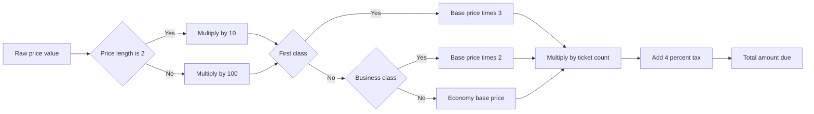
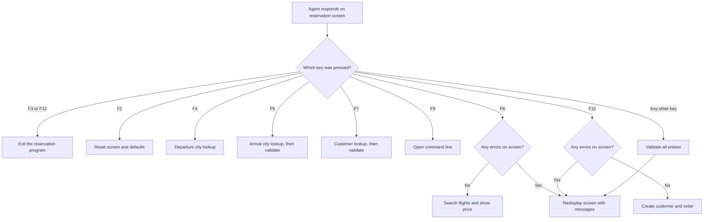
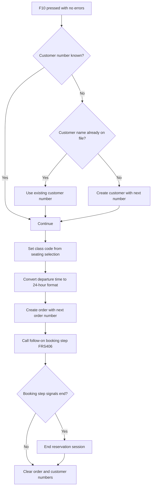
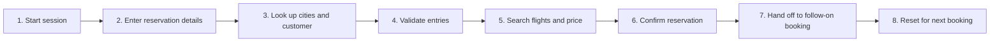
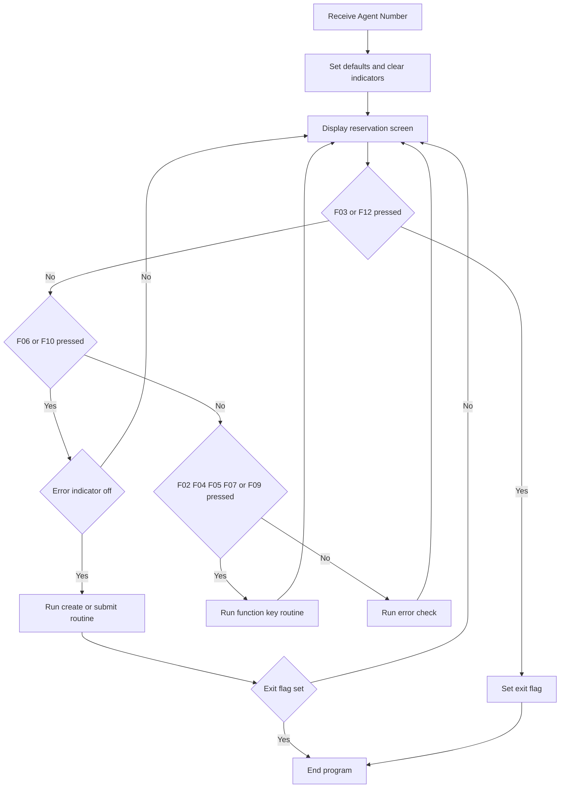
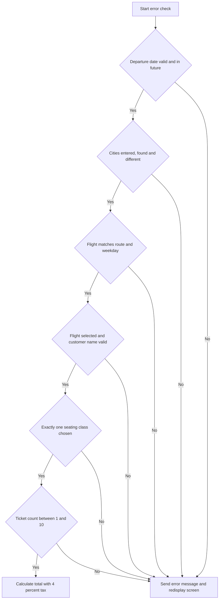

# 1. Executive Summary

**Program:** Flight Reservation Entry (`FRS001`)

**Business Purpose:** This interactive program lets a travel agent book airline tickets for a customer. The agent enters a travel date, origin, destination, flight, seating class, number of tickets and passenger name. The program checks the entries, shows the flight and price, and creates the reservation (order) when the agent confirms.

**Key Business Functions:**
- Identifies the travel agent working the session by a 9-digit Agent Number supplied when the program starts.
- Validates the travel date, cities, flight, customer, seating class and ticket quantity before any booking is made.
- Offers lookup lists for departure city, arrival city and customer, and a flight search for the chosen route and date.
- Prices the booking: a seating-class multiplier on the base fare, multiplied by the ticket quantity, plus a 4% sales tax.
- Finds or creates the customer record and assigns the next customer number.
- Creates the order with the next order number and the class of service, and stores the departure time in 24-hour format.
- Hands the new order to a follow-on booking step (`FRS406`) and clears the session so the agent can start the next reservation.

**Business Context:** `FRS001` is the front-end of the reservation process. It brings together several supporting functions: city lookup (`FRS402`, `FRS403`), flight search (`FRS404`), customer selection (`FRS405`) and the follow-on booking step (`FRS406`). It also relies on IBM i system services for date checking, message handling and the command line. The program is controlled by function keys. Booking can only be saved when the screen has no outstanding errors.

---

# 2. Detailed Business Rules

## 2.1 General Domain

### Agent Identification on Entry
**Category:** Business Process
**Domain:** General

**Description:** The program expects a 9-digit Agent Number when it starts. This identifies the travel agent performing the reservations.

**Trigger Conditions:**
- The program is started with an Agent Number.

**Business Outcome:**
- The Agent Number is held for the session so it can be associated with the reservation activity.

**Related Data:** `AGENT#`

### Reservation Screen Display Cycle
**Category:** Business Process
**Domain:** General

**Description:** The reservation screen is shown and the program waits for the agent's input. Nothing is validated or processed until the agent responds.

**Trigger Conditions:**
- The reservation program is active and in its repeating screen cycle.

**Business Outcome:**
- Pending messages are shown with the entry screen, and the agent's input drives the next step.

**Related Data:** Reservation entry screen, message area

### Function Key Handling

| Rule Name | Trigger | Outcome | Related Data |
|-----------|---------|---------|--------------|
| Exit or Cancel | Agent presses F3 or F12 | Exit flag is set and the program ends | Exit flag |
| Start New Search | Agent presses F2 | Screen is reset to a clean starting state (see Session Reset below) | Screen fields, messages |
| Departure City Lookup | Agent presses F4 | City and airport selection list (`FRS402`) is shown; the chosen city and airport code are returned | Departure city, airport code |
| Arrival City Lookup | Agent presses F5 | Arrival city selection list (`FRS403`) is shown; the selection is then validated | Arrival city |
| Flight Search | Agent presses F6, no errors on screen | Day of week is resolved, flights are searched and details displayed | Date, cities, flight details |
| Customer Lookup | Agent presses F7 | Customer number is cleared and the customer selection program (`FRS405`) is shown; the selection is then validated | Customer number, customer name |
| Command Line | Agent presses F9 | The system command line opens | System command line |
| Create Reservation | Agent presses F10, no errors on screen | Customer and order are created and the booking is handed on | Customer, order |
| Automatic Validation | Agent presses any other key | Full entry validation is run | All entry fields |

### Booking Allowed Only When Error-Free
**Category:** Decision
**Domain:** General

**Description:** The flight search (F6) and reservation creation (F10) run only when the screen has no validation errors. F10 also requires that the session is not already ending.

**Trigger Conditions:**
- Agent presses F6 or F10 and no error is flagged on the screen.

**Business Outcome:**
- With no errors, the search or reservation proceeds and the screen is refreshed if required.
- With errors, the agent must correct them first.

**Related Data:** Error indicator, function key pressed

### Message Queue Clearing and Message Delivery
**Category:** Business Process
**Domain:** General

**Description:** Old messages are cleared before the screen is refreshed so stale errors are not shown. When a validation problem is found, a descriptive message is sent to the agent.

**Trigger Conditions:**
- Messages are cleared when the agent starts a new search with F2.
- A message is sent whenever a validation rule is violated.

**Business Outcome:**
- The agent sees only current, relevant messages that explain what to correct.

**Related Data:** Message ID, message file, message data

### Session Context Reset After Booking
**Category:** Business Process
**Domain:** General

**Description:** After a reservation is processed, the working order number and customer number are set to zero. This prevents data from one booking carrying into the next.

**Trigger Conditions:**
- Reservation creation (F10) has finished.

**Business Outcome:**
- The next reservation starts with no order or customer pre-selected.

**Related Data:** `ORDER#`, `CUST#`

## 2.2 Order Domain

### Startup Defaults
**Category:** Business Process
**Domain:** Order

**Description:** When the program starts, it sets defaults and a clean screen state.

**Trigger Conditions:**
- Program start-up.

**Business Outcome:**
- Departure year is set to the current year, using a 20xx century prefix.
- Seating class defaults to Economy and ticket quantity defaults to 1.
- All error flags are cleared.
- The protection state of the screen is set (protected until the agent presses F6).
- The message area is cleared and the exit control is set to "continue".

**Related Data:** `DOFYR`, `COSECO`, `TCKETS`, message fields

### Session Reset (F2)
**Category:** Business Process
**Domain:** Order

**Description:** F2 returns the reservation screen to a clean starting point.

**Trigger Conditions:**
- Agent presses F2.

**Business Outcome:**
- The screen is protected, all errors are cleared, and entry fields are reset.
- The departure year is pre-filled with the current year.
- The seating class defaults to Economy and ticket quantity to 1.
- All pending messages are removed.

**Related Data:** Reservation screen fields, `DOFYR`, `COSECO`, `TCKETS`

### Departure Date Validation
**Category:** Validation
**Domain:** Order

**Description:** The departure date must be complete, a real calendar date, and in the future.

**Trigger Conditions:**
- Month, day or year is zero or missing.
- The date is not a valid calendar date (checked by the system date conversion service).
- The date is today or in the past.

**Business Outcome:**
- The error is flagged, the date field is highlighted and the agent receives a message explaining the problem.
- Validation stops and the screen is shown again.

**Related Data:** Departure month, day and year, current system date

### Origin and Destination Validation
**Category:** Validation
**Domain:** Order

**Description:** Both cities must be provided, must exist in the city master tables, and must differ.

**Trigger Conditions:**
- Departure city or arrival city is blank.
- A city is not found in its master table.
- Departure and arrival cities are the same.

**Business Outcome:**
- The agent is shown a specific message for each case and must correct the entry.

**Related Data:** `FRCITY.FRCNAM`, `TOCITY.TOCNAM`

### Flight Matches Route and Day of Week
**Category:** Validation
**Domain:** Order

**Description:** When a flight number is selected, the flight must operate between the chosen cities on the weekday of the chosen departure date.

**Trigger Conditions:**
- A flight number is present and its route or operating day does not match the entries.

**Business Outcome:**
- The agent is told the flight does not match the criteria and must correct the entry.

**Related Data:** `FLIGHTSZ.FLGHTN`, `FLIGHTSZ.DPCNAM`, `FLIGHTSZ.ARCNAM`, `FLIGHTSZ.DYOFWK`

### Flight Search and Display Preparation
**Category:** Business Process
**Domain:** Order

**Description:** On F6, the program works out the weekday name of the departure date and prepares the departure and arrival city names for display. It then calls the flight search (`FRS404`) with the route and date.

**Trigger Conditions:**
- Date and both cities are entered, and no errors are present.

**Business Outcome:**
- If a flight is found, its flight number, departure time, arrival time and airline are shown.
- If no flight is found, the screen goes back to its entry layout and no flight details are shown.

**Related Data:** Departure date, cities, flight key, flight times, airline

### Class of Service Recorded on the Order
**Category:** Decision
**Domain:** Order

**Description:** The class stored on the order is taken from the seating class chosen.

**Trigger Conditions:**
- A First Class, Business Class or Economy selection is present, checked in that order.

**Business Outcome:**

| Selection | Class Recorded on Order |
|-----------|-------------------------|
| First Class | 1 |
| Business Class | 2 |
| Economy | 3 |

**Related Data:** `ORDERS.CLASS`

### 24-Hour Departure Time Storage
**Category:** Calculation
**Domain:** Order

**Description:** The departure time is stored in 24-hour format.

**Trigger Conditions:**
- The departure indicator is PM and the hour is not 12.

**Business Outcome:**
- 12 is added to the hour. Date and time parts are copied into the order's departure timestamp.

**Related Data:** `ORDERS.DEPAR00001`, `FLIGHTS.DEPAR00002`

### New Order Creation
**Category:** Business Process
**Domain:** Order

**Description:** A new order is written with the next order number, which is one higher than the highest existing order number.

**Trigger Conditions:**
- Customer, class, ticket count and departure time have all been resolved.

**Business Outcome:**
- A new order record is added with customer, flight, departure, ticket and class information.

**Related Data:** `ORDERS.ORDER00001`, `ORDERS.CUSTO00001`, `ORDERS.FLIGH00001`, `ORDERS.DEPAR00001`, `ORDERS.TICKE00001`, `ORDERS.CLASS`

### Follow-On Booking Step
**Category:** Business Process
**Domain:** Order

**Description:** After the order is written, `FRS406` is called with the new order number to select a start interval for the booking.

**Trigger Conditions:**
- A new order has just been created.

**Business Outcome:**
- If `FRS406` signals that processing should end, the reservation session terminates.
- Otherwise the session continues.

**Related Data:** `ORDERS.ORDER00001`

## 2.3 Customer Domain

### Flight and Customer Name Required
**Category:** Validation
**Domain:** Customer

**Description:** A flight must be selected before a passenger can be booked. A customer name must be entered and contain only valid characters.

**Trigger Conditions:**
- No flight is selected, the name is blank, or the name has invalid characters.

**Business Outcome:**
- The booking is blocked and a specific message is shown for each case.

**Related Data:** `CUSTOMERS.CUSTO00002`

### Customer Selection (F7)
**Category:** Business Process
**Domain:** Customer

**Description:** The customer number is cleared and a customer selection list (`FRS405`) is shown. The selection is validated afterward.

**Trigger Conditions:**
- Agent presses F7.

**Business Outcome:**
- The chosen customer is returned and checked with the standard validation.

**Related Data:** `CUSTOMERS.CUST#`, `CUSTOMERS.CUSNAM`

### Customer Find-or-Create
**Category:** Business Process
**Domain:** Customer

**Description:** If no customer number is set, the system looks up the customer by name. If the name is not found, a new customer is created with the next sequential customer number. If it is found, the existing number is used.

**Trigger Conditions:**
- Customer number is zero when the reservation is created (F10).

**Business Outcome:**
- Unknown names produce a new customer record, numbered one higher than the highest existing number.
- Known names reuse the existing customer number, which avoids duplicate customers.

**Related Data:** `CUSTNAME.CUSTNM`, `CUSTOMER.CNUMBR`, `CUSTOMERS.CUSTO00001`, `CUSTOMERS.CUSTO00002`

## 2.4 Financial Domain

### Seating Class Selection and Class Multiplier
**Category:** Calculation
**Domain:** Financial

**Description:** Exactly one seating class must be selected. The base fare is adjusted by the class chosen.

**Trigger Conditions:**
- Class selection is checked during validation and again when the price is shown.

**Business Outcome:**

| Class | Price Treatment |
|-------|-----------------|
| First Class | 3 × base fare |
| Business Class | 2 × base fare |
| Economy | Base fare |

- If no class is chosen, or more than one is chosen, the agent receives an error message.

**Related Data:** `FLIGHTS.TICKE00001`, class selections

### Ticket Quantity Limits and Total Cost
**Category:** Calculation
**Domain:** Financial

**Description:** A reservation must include 1 to 10 tickets. The total is the ticket subtotal plus 4% sales tax.

**Trigger Conditions:**
- Ticket quantity is 0, or above 10 (error).
- Ticket quantity is 1 or more (price is calculated).

**Business Outcome:**
- Quantities of 0 or more than 10 produce an error message.
- Otherwise the system calculates the subtotal, the tax and the total.

**Related Data:** `FLIGHTS.TICKE00001`, `TCKETS`, tax due, total

### Base Price Conversion
**Category:** Calculation
**Domain:** Financial

**Description:** The fare returned by the flight search is converted into a full currency amount using a decimal-position indicator.

**Trigger Conditions:**
- A flight was found, and a price with a position indicator is returned.

**Business Outcome:**
- If the indicator is 2, the raw value is multiplied by 10. Otherwise it is multiplied by 100.

**Related Data:** `PRICEN`, `PRICEL`, `PRICE`

---

# 3. Validations and Exceptions

All checks run when the agent submits input with a key other than the navigation keys. The F5 destination lookup and F7 customer lookup also trigger the checks. Each failure shows a message and stops the booking until corrected.

| Area | Validation | Failure Response |
|------|------------|------------------|
| Travel Date | Month, day and year all entered | Error flagged; message FRS0058 |
| Travel Date | Valid calendar date | Date field highlighted; message FRS0059; date error flag set to block processing |
| Travel Date | Strictly after today | Error flagged; message FRS0060 |
| Departure City | Not blank | Message FRS0061 |
| Departure City | Exists in the city master | Message FRS0062 |
| Arrival City | Not blank | Message FRS0071 |
| Arrival City | Exists in the city master | Message FRS0072 |
| Route | Departure and arrival differ | Message FRS0075 |
| Flight | Matches route and weekday | Error flagged; message FRS0040 |
| Flight | Flight selected before booking | Error flagged; message FRS0021 |
| Customer | Name not blank | Error flagged; message FRS0065 |
| Customer | Name has valid characters | Error flagged; message FRS0066 |
| Seating Class | A class is selected | Message FRS0081 |
| Seating Class | Only one class selected | Message FRS0082 |
| Tickets | At least 1 | Message FRS0085 |
| Tickets | No more than 10 | Message FRS0086 |

**Exception Handling and Recovery:**
- ⚠️ If the flight search returns no flight, the screen reverts to its entry layout and no details are shown. The agent can change the search.
- ⚠️ The F5 and F7 lookups are validated right after selection, so a bad selection is caught immediately.
- ✅ F2 clears all errors and messages for a fresh start.
- ❌ F6 and F10 do nothing while errors remain on the screen.

**Business Impact:** These checks prevent bookings for past or non-existent dates, unknown or identical cities, mismatched flights, unnamed customers, ambiguous classes and out-of-range ticket counts.

---

# 4. Calculation Rules

| Calculation | Formula | Inputs | Output | Rationale |
|-------------|---------|--------|--------|-----------|
| Base Price Conversion | Raw price × 10 if the position indicator is 2, otherwise × 100 | Raw price, position indicator | Base fare | Converts the stored fare into a full currency amount |
| Class-Adjusted Price | First Class: base × 3. Business: base × 2. Economy: base × 1 | Base fare, selected class | Adjusted unit price | Premium cabins cost more |
| Ticket Subtotal | Adjusted unit price × number of tickets | Adjusted price, ticket count | Gross ticket price | Cost of the whole party |
| Sales Tax | Ticket subtotal × 4% | Ticket subtotal | Tax due | Mandatory tax on every reservation |
| Total Reservation Cost | Ticket subtotal + tax due | Ticket subtotal, tax due | Total due | Final amount payable |
| Default Departure Year | "20" + current two-digit system year | System year | Departure year | Pre-fills a four-digit year |
| Class Code | First Class = 1, Business = 2, Economy = 3 | Selected class | Order class code | Stores the class in a compact form |
| 24-Hour Departure Time | If PM and hour is not 12, hour + 12 | Hour, AM/PM indicator | 24-hour time | Consistent time storage |
| Next Customer Number | Highest existing customer number + 1 | Customer file | New customer number | Unique sequential customer IDs |
| Next Order Number | Highest existing order number + 1 | Order file | New order number | Unique sequential order IDs |

**Pricing Example (illustrative):** A base fare of 200 in Business Class for 2 tickets gives an adjusted price of 400 and a subtotal of 800. Tax is 32 and the total is 832.

---

# 5. Decision Logic

#### Ticket Price Calculation Logic

## Key Press Decision

Each time the agent responds, the program decides what to do based on the key pressed:

## Reservation Creation (F10)

## Other Decision Points

| Decision Point | Conditions Evaluated | Possible Outcomes | Business Impact |
|----------------|----------------------|-------------------|-----------------|
| Flight found | Flight search returns a result or not | Details shown, or screen reverts to entry layout | Agent either proceeds or revises the search |
| Class pricing | First, Business or Economy selected | 3×, 2× or 1× the base fare | Premium cabins priced higher |
| Class code | First non-blank class cost | Code 1, 2 or 3 | Order records the class |
| Price scaling | Position indicator equals 2 or not | ×10 or ×100 | Correct currency amount |
| Time conversion | PM and hour not 12 | Add 12 hours, or leave unchanged | 24-hour times on orders |

---

# 6. Data Integrity Rules

| Rule | Description | Business Reason |
|------|-------------|-----------------|
| Sequential customer numbers | A new customer receives the highest existing number plus 1, read from the customer file in descending number order | Each customer has a unique ID |
| Sequential order numbers | A new order receives the highest existing order number plus 1 | Each reservation has a unique ID |
| No duplicate customers by name | Customer name is checked against the name index before a new customer is created | Prevents duplicate records and keeps booking history together |
| City master references | Departure and arrival cities must exist in their master tables | Bookings only use recognised locations |
| Flight schedule consistency | The flight must match the route and operating weekday | Prevents booking flights that do not operate that day |
| Valid customer name characters | Names must pass a character check | Keeps customer records clean |
| Error-free save | F6 and F10 are blocked while errors exist | Only validated reservations are saved |
| Order completeness | The order is written only after customer, class, tickets and departure time are resolved | Orders are never partially populated |
| Session clearing | Order and customer numbers are reset after each booking | Prevents data from leaking between bookings |

The source data does not describe explicit database constraints, triggers or rollback handling, so none are documented here.

---

# 7. Business Process Flow

1. **Start Session**
   - The agent's 9-digit number is received, and defaults and a clean screen are set (current year, Economy, 1 ticket).
   - Next step: the reservation screen is displayed.

2. **Enter Reservation Details**
   - The agent enters the travel date, cities, flight, seating class, ticket quantity and customer name.
   - F2 resets the screen at any time.

3. **Look Up Cities and Customer**
   - F4, F5 and F7 open selection lists for departure city, arrival city and customer (`FRS402`, `FRS403`, `FRS405`).
   - Arrival city and customer selections are validated as soon as they return.

4. **Validate Entries**
   - Date, cities, route, flight, customer name, seating class and ticket quantity are checked.
   - Any failure shows a message and returns the agent to the screen.

5. **Search Flights and Price**
   - With no errors, F6 resolves the weekday and searches for flights (`FRS404`).
   - The base fare is converted, the class multiplier applied, and the subtotal, tax and total calculated.
   - If no flight is found, the agent revises the search.

6. **Confirm Reservation**
   - With no errors, F10 finds or creates the customer, sets the class code, converts the departure time and writes the order.

7. **Hand Off to Follow-On Booking**
   - `FRS406` receives the new order number. If it signals the end, the session closes.

8. **Reset for Next Booking**
   - The order and customer numbers are cleared. The agent can book again, or exit with F3 or F12.

**Integration Points:**
- Supporting programs: `FRS402`, `FRS403`, `FRS404`, `FRS405`, `FRS406`.
- Files: city masters, flight schedule, customer files (including the name index), and orders.
- System services: date conversion (`QWCCVTDT`), message removal (`QMHRMVPM`), message sending (`QMHSNDPM`), and the command line (`QUSCMDLN`).

---

#### Reservation Entry Main Loop

#### Reservation Input Validation Sequence

# 8. Assumptions and Notes

## Explicit Rules (clearly stated in the program)
- ✅ The program receives a 9-digit Agent Number on entry.
- ✅ F3 and F12 exit. F2, F4, F5, F6, F7, F9 and F10 perform the functions described above.
- ✅ F6 and F10 run only when no error is flagged.
- ✅ Departure date must be complete, valid and in the future.
- ✅ Cities are required, must exist, and must differ.
- ✅ Flight must match the route and weekday. A flight is required, and a customer name is required with valid characters.
- ✅ Exactly one seating class is required. Pricing is 3× (First), 2× (Business) and 1× (Economy).
- ✅ Tickets must be 1 to 10. Tax is 4%.
- ✅ The new customer number and the new order number are each the highest existing number plus 1.
- ✅ Class codes are 1, 2 and 3. PM times are shifted by 12 hours unless the hour is 12.

## Inferred Rules
- ⚠️ The F12 behaviour is inferred from the subroutine's name and content. The program section that calls it was not fully read.
- ⚠️ The F7 customer lookup is inferred from the call to `FRS405`, whose logic was not reviewed. The program's own comments for F7 refer to "F3" and "return start time". They appear to be copied from another program and do not match the behaviour.
- ⚠️ The "Agent Number" rule is classed as authorization. The program only receives and holds the number, and no check on it is visible.

## Assumptions
- The "20" century prefix, the 4% tax rate and the 1–10 ticket limit are treated as current business policy.
- The follow-on booking step (`FRS406`) is assumed to handle the next stage of the booking, such as start interval selection.

## Ambiguities Requiring Business Clarification
- ❓ **Agent authorization:** Is any check needed on the Agent Number, or is it only for tracking?
- ❓ **Price position indicator:** The rule for multiplying the fare by 10 or by 100 depends on a position indicator. Confirm the intended meaning.
- ❓ **Midnight and noon times:** 12 AM (midnight) is not adjusted. Confirm it is treated correctly.
- ❓ **Pricing consistency:** The class multiplier and totals are calculated in both the validation step and the flight search step. Confirm both produce the same result.
- ❓ **Customer name matching:** The program matches by name only. Two different customers with the same name would be treated as one.
- ❓ **Departure date in the past:** Same-day travel is rejected. Confirm that is intended.

## Technical Limitations Requiring Business Review
- ⚠️ **Command line access (F9):** The program does not check whether a user may open a command line. Any restriction relies on the user's own system authority.
- ⚠️ **Concurrent bookings:** Customer and order numbers are found by reading the highest existing number. Two agents saving at the same moment could get the same number.
- ⚠️ **Hard-coded century:** The "20" prefix will need review in a future century.
- ⚠️ **Hard-coded values:** The 4% tax rate, the class multipliers and the 10-ticket limit are fixed in the program. Any change requires a program change.