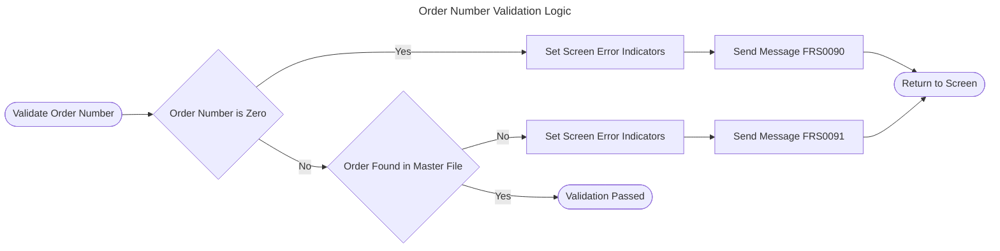
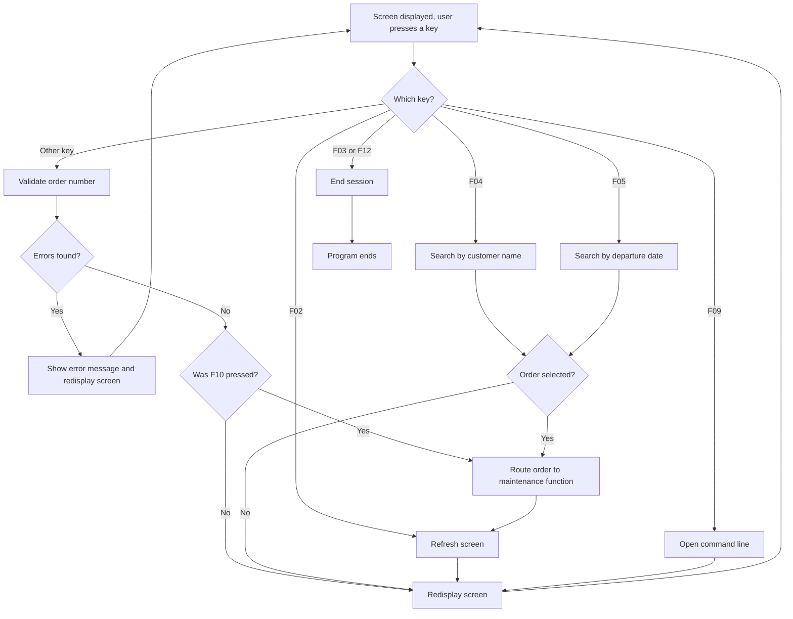
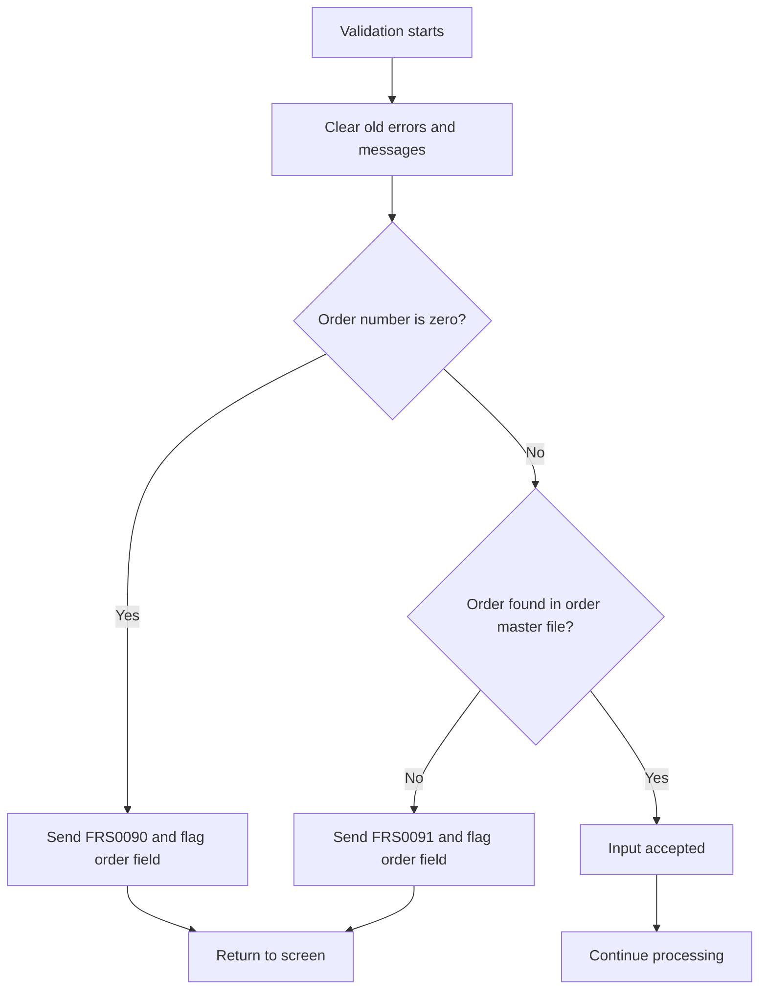
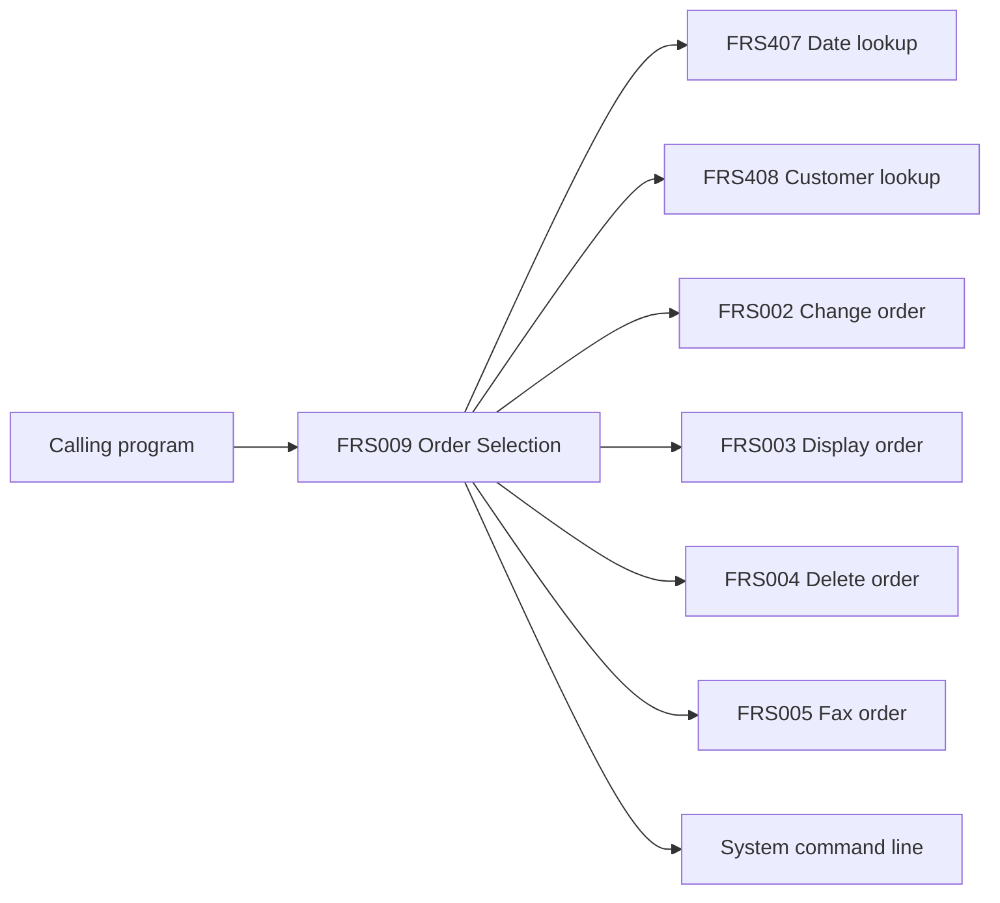
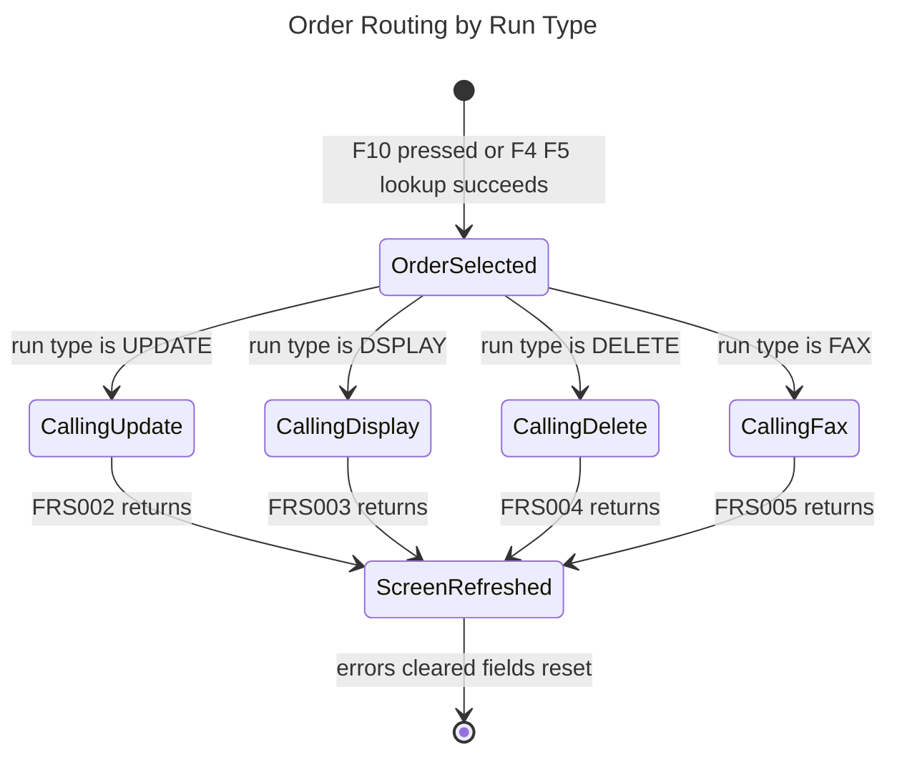
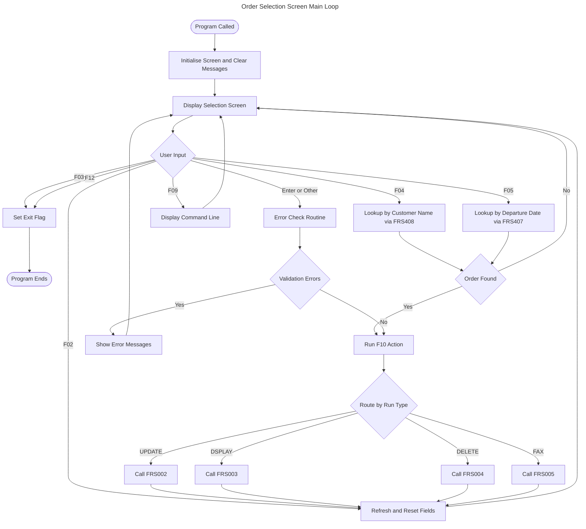

# 1. Executive Summary

**Program:** FRS009, Order Selection Screen

**Business Purpose:** FRS009 is an interactive order selection screen. A travel agent uses it to identify one order and send it to the right order maintenance function. The calling program supplies the agent number and a run type. The run types seen in the rules are update, display, delete and fax.

**Key Business Functions:**
- Prompts the user for an order number and checks that it is entered and exists in the order master file.
- Lets the user search for an order by customer name (F4) or by departure date (F5) when the number is not known.
- Sends the selected order, with the agent number, to the program for the run type: change (FRS002), display (FRS003), delete (FRS004) or fax (FRS005).
- Clears old errors and messages so the user only sees current problems.
- Lets the user refresh the screen (F2), exit (F3), cancel (F12), or open a system command line (F9).

**Business Context:** FRS009 is a front-end selection step. It does not change order data itself. It makes sure the user picks a valid order, then hands control to the specialised order programs. The screen stays up and is redisplayed until the user exits, so several orders can be handled in one session.

---

# 2. Detailed Business Rules

## 2.1 Order Domain

### Interactive Order Selection Session
**Category:** Business Process
**Domain:** Order

**Description:** The program runs as a repeating screen session. It is started with an agent number and a run type, and the selection screen is reset. Any pending messages are shown, then the screen is displayed and the program waits for the user. This repeats until the user chooses to exit.

**Trigger Conditions:**
- The program is called with an agent number and a run type.
- The user has not yet chosen to exit.

**Business Outcome:**
- The selection screen is reset and displayed with any pending messages.
- The session continues until the user exits.
- When the user exits, the program ends.

**Related Data:** Selection screen (`FRS009DF.SELCTR`), message display area (`FRS009DF.MSGCTL`)

---

### Order Number Must Be Entered and Must Exist
**Category:** Validation
**Domain:** Order

**Description:** The user must enter an order number, and it must match an existing order. Checking stops at the first error found.

**Trigger Conditions:**
- The order number is zero.
- The order number is not found in the order master file.

**Business Outcome:**
- The order number field is highlighted as being in error.
- Message FRS0090 is sent when the order number is zero.
- Message FRS0091 is sent when the order is not found.
- Remaining checks are skipped and the user returns to the screen.

**Related Data:** Order number (`ORDNMZ.ORDER`, `ORDERS.ORDER00001`)

---

### Order Lookup by Customer Name or Departure Date
**Category:** Business Process
**Domain:** Order

**Description:** If the user does not know the order number, F4 searches by customer name and F5 searches by departure date. Both use a separate lookup program. Only one search criterion applies at a time.

**Trigger Conditions:**
- The user presses F4 (customer name) or F5 (departure date).
- The lookup returns a non-zero order number.

**Business Outcome:**
- **F4:** The lookup program FRS408 is called with the customer name, and the departure year, month and day are cleared.
- **F5:** The lookup program FRS407 is called with the departure year, month and day, and the customer name is cleared.
- If an order is chosen, the program continues as if the user had pressed F10 for that order.
- If no order is chosen, the user returns to the screen with no further action.

**Related Data:** Order number (`ORDERS.ORDER00001`), customer (`ORDERS.CUSTO00001`), departure date (`ORDERS.DEPAR00001`)

---

### Route Selected Order to the Maintenance Function
**Category:** Decision
**Domain:** Order

**Description:** When the user confirms the selection with F10, or after a successful F4/F5 lookup, the order goes to the program for the run type. The agent number and order number are passed on.

**Trigger Conditions:**
- The run type is UPDATE, DSPLAY, DELETE or FAX.

**Business Outcome:**

| Run Type | Business Function | Program Called |
|----------|-------------------|----------------|
| UPDATE | Change the order | FRS002 |
| DSPLAY | Display the order | FRS003 |
| DELETE | Delete the order | FRS004 |
| FAX | Send the order by fax | FRS005 |

- After the call returns, the screen is refreshed: error indicators are cleared, the selection fields are reset and messages are removed.
- For any other run type, no program is called and only the refresh occurs.

**Related Data:** Agent number (`ORDERS.AGENT_NO`), order number (`ORDERS.ORDER00001`)

---

### Record Action Only When Input Is Error-Free
**Category:** Validation
**Domain:** Order

**Description:** The F10 action runs only if the program is not ending and the screen has no validation errors. If there are errors, nothing is processed.

**Trigger Conditions:**
- The user pressed F10.
- The program is not ending.
- The screen input has no validation errors.

**Business Outcome:**
- The F10 action runs, and the order goes to the maintenance function.
- If any condition is not met, the action is skipped and the user stays on the screen.

**Related Data:** Function key (`FRS009DF.KEY`), order file (`ORDERSZ.ORDER00001`, read-only in this program)

---

## 2.2 General Domain

### Function Key Controls the Next Action
**Category:** Decision
**Domain:** General

**Description:** The key the user presses decides what the program does next.

| Key | Business Action |
|-----|-----------------|
| F02 | Refresh the screen |
| F03 | Exit |
| F04 | Find an order by customer name |
| F05 | Find an order by departure date |
| F09 | Open a command line |
| F12 | Cancel |
| Enter or any other key | Run the input validation check |

**Related Data:** Function key (`FRS009DF.KEY`)

---

### Clear Old Errors and Messages
**Category:** Business Process
**Domain:** General

**Description:** Old error indicators and messages are cleared at set points, so the user sees only current errors.

**Trigger Conditions:**
- Validation is about to run.
- The user presses F2.
- The program starts.

**Business Outcome:**
- Screen error indicators are turned off.
- Earlier messages are removed from the program's message queue.
- On F2, the selection fields are also reset.
- On program start, the message ID and message data are blanked and the exit flag is set to false.

**Related Data:** Selection screen fields, program message queue

---

### Exit and Cancel
**Category:** Business Process
**Domain:** General

**Description:** F3 (exit) and F12 (cancel) behave identically here. Each ends the screen session without further processing.

**Trigger Conditions:**
- The user presses F3 or F12.

**Business Outcome:**
- The exit flag is set and the screen loop ends.

**Related Data:** None

---

### Command Line Access
**Category:** Business Process
**Domain:** General

**Description:** F9 opens the system command line from the selection screen.

**Trigger Conditions:**
- The user presses F9.

**Business Outcome:**
- The system command line is displayed.

**Related Data:** None

---

## 2.3 Summary Table

| Rule Name | Trigger | Outcome | Related Data |
|-----------|---------|---------|--------------|
| Interactive Order Selection Session | Program called with agent and run type | Screen repeats until the user exits | Selection screen, messages |
| Order Number Validation | Zero or unknown order number | Error FRS0090 or FRS0091 | Order number |
| Order Lookup | F4 or F5 | Order chosen via FRS408 or FRS407 | Customer, departure date |
| Route to Maintenance | F10 or successful lookup | Calls FRS002, FRS003, FRS004 or FRS005 | Agent, order |
| Action Only When Error-Free | F10 with no errors | Order is processed | Function key |
| Function Key Control | Any key press | Matching routine runs | Function key |
| Clear Old Errors | Validation, F2 or start | Clean screen | Messages |
| Exit and Cancel | F3 or F12 | Session ends | None |
| Command Line | F9 | Command line shown | None |

---

# 3. Validations and Exceptions

## 3.1 Data Quality Validations

| Validation | Condition Failed | User Message | Business Impact |
|------------|------------------|--------------|-----------------|
| Order number required | Order number is zero | FRS0090 | No order is processed. The order field is highlighted. |
| Order must exist | Order number not in the order master file | FRS0091 | Prevents work on non-existent orders. The order field is highlighted. |

## 3.2 Business Rule Gate

- ✅ The order is sent to the maintenance function only if the user pressed F10, the program is not ending, and no validation errors are flagged.
- ❌ If input errors exist, the user stays on the screen and must correct the order number.

## 3.3 Exception Handling and Recovery

- 🔄 **Fail-fast checking:** Validation stops at the first error, so the user sees one problem at a time.
- 🔄 **Clean slate before each check:** Earlier errors and messages are removed first, so old messages do not mix with new ones.
- 🔄 **Empty lookup result:** If F4 or F5 finds no order, the user returns to the screen with no error and can try again.
- ⚠️ **Unrecognised run type:** No maintenance program is called and the screen is refreshed. No message is shown.
- 📝 The wording of messages FRS0090 and FRS0091 is not in the analysed material.

---

# 4. Calculation Rules

No arithmetic or financial calculations were identified. The program only validates, routes and resets data.

The only value changes are these field resets:

| Calculation | Formula | Inputs | Output | Rationale |
|-------------|---------|--------|--------|-----------|
| Clear departure date on customer search | Set year, month and day to zero | F4 pressed | Departure date cleared | Only one search criterion applies at a time |
| Clear customer name on date search | Set customer name to blank | F5 pressed | Customer name cleared | Only one search criterion applies at a time |
| Reset selection fields on refresh | Return selection fields to initial values | F2 pressed, or after routing | Blank selection screen | Gives the user a clean screen for the next order |

---

# 5. Decision Logic

#### ---

## 5.1 Function Key Handling

**Decision Point:** What should the program do after the user presses a key?

**Conditions Evaluated:** The function key pressed and whether the screen input has errors.

**Possible Outcomes:**
- F02: refresh the screen.
- F03 or F12: end the session.
- F04 or F05: run a lookup, then route the order if one is found.
- F09: open the command line.
- Any other key, including Enter: validate the input. Then, if the user pressed F10 and there are no errors, route the order.

**Business Impact:** Every user action leads to a defined result, and invalid input never reaches the maintenance programs.

## 5.2 Run Type Routing

**Decision Point:** Which maintenance function handles the selected order?

**Conditions Evaluated:** The run type supplied by the calling program.

**Possible Outcomes:**

| Run Type | Outcome | Business Impact |
|----------|---------|-----------------|
| UPDATE | Order change program FRS002 | The order can be amended |
| DSPLAY | Order display program FRS003 | The order can be viewed |
| DELETE | Order deletion program FRS004 | The order can be removed |
| FAX | Order fax program FRS005 | The order details can be faxed |
| Other | No program called | Screen refreshed, no action |

## 5.3 Order Number Validation

---

# 6. Data Integrity Rules

| Rule | Description | Business Reason |
|------|-------------|-----------------|
| Unique order number | The order master file is keyed on the order number, so each order is unique. | Each lookup finds exactly one order, so no wrong order is changed, deleted or faxed. |
| Existing-order check | An order number is accepted only if it exists in the order master file. | Prevents work on non-existent orders. |
| Read-only access | The order file used by this program is opened for reading only. | The selection step cannot change order data. Changes happen only in FRS002 and FRS004. |
| One search criterion at a time | Searching by name clears the date, and searching by date clears the name. | Avoids ambiguous or conflicting search criteria. |
| Clean message state | Old messages are removed before new ones are issued. | Users are not misled by outdated errors. |

📝 No database triggers, foreign-key rules or transaction boundaries were identified in this program.

---

# 7. Business Process Flow

1. **Start the Session**
   - The calling program passes the agent number and the run type.
   - The selection screen is reset, the message area is cleared and the exit flag is set to false.
   - Next: display the screen.

2. **Display the Selection Screen**
   - Pending messages are shown, then the screen is displayed.
   - The program waits for the user.
   - Next: act on the key pressed.

3. **Identify the Order**
   - **Direct entry:** The user types the order number and presses Enter or F10.
   - **Search by customer name (F4):** FRS408 helps select the order.
   - **Search by departure date (F5):** FRS407 helps select the order.
   - Next: validate, or route directly if a search selected an order.

4. **Validate the Input**
   - Old errors and messages are cleared.
   - The order number must be non-zero (FRS0090) and must exist (FRS0091).
   - If an error is found, the message is shown and the process returns to Step 2.

5. **Route to the Maintenance Function**
   - The order is sent to the program for the run type: FRS002, FRS003, FRS004 or FRS005.
   - The agent number and order number are passed.
   - Next: refresh.

6. **Refresh and Repeat**
   - Error indicators are cleared, the selection fields are reset and messages are removed.
   - The process returns to Step 2 so another order can be selected.

7. **End the Session**
   - The user presses F3 or F12, which sets the exit flag.
   - The program ends.

**Integration Points:**
- **Calling program:** supplies the agent number and run type.
- **Lookup programs:** FRS407 (by departure date) and FRS408 (by customer name).
- **Maintenance programs:** FRS002, FRS003, FRS004 and FRS005.
- **System services:** the program message queue and the system command line.

---

#### ---

#### ---

# 8. Assumptions and Notes

## 8.1 Explicit Rules (Clearly Stated in the Program)
- ✅ A zero order number is rejected with message FRS0090.
- ✅ An order not found in the order master file is rejected with message FRS0091.
- ✅ F3 and F12 both end the session.
- ✅ F9 opens the system command line.

## 8.2 Inferred Rules (Deduced from Program Patterns)
- 📝 The messages for the F4, F5, F9 and F10 routines are not visible, but the F10 routine appears to confirm the selection and route the order.
- 📝 FRS407 and FRS408 are taken to be the departure-date and customer-name lookups, based on the values passed to them.
- 📝 FRS002, FRS003, FRS004 and FRS005 are taken to be the change, display, delete and fax programs, based on run type values and program numbers.
- 📝 Keys not listed explicitly, including F10, appear to go through the input validation check. This is why F10 acts only when no errors are flagged.
- 📝 The run type value 'D' is described in a program comment as "delete", but the routing logic uses the longer values UPDATE, DSPLAY, DELETE and FAX.

## 8.3 Assumptions
- The calling program supplies a valid agent number. The program does not check it.
- Exit conditions that are set in routines not fully reviewed behave as the rules describe.

## 8.4 Ambiguities Requiring Business Clarification
- ⚠️ **Run type values:** The comment describes 'D' as delete, but the routing uses the full words. Please confirm which values callers actually send.
- ⚠️ **Unrecognised run types:** No message is shown and no function is run. Should the user be told?
- ⚠️ **Message wording:** The text of FRS0090 and FRS0091 was not available for review.
- ⚠️ **F10 validation:** It is not confirmed that validation always runs before the F10 action. The F4/F5 lookup path routes a selected order without the standard validation.
- ⚠️ **Order file used by the check:** The exact file behind the order lookup (ORDNMZ) was not shown. The order master file is keyed on the order number.
- ⚠️ **Agent ownership:** The agent number is passed on but not checked against the order. Please confirm whether an agent may work only on their own orders.

## 8.5 Technical Limitations and Review Points
- ⚠️ Comments for F04, F05 and F09 read "F03 EXIT", which looks like a copy-and-paste error and could mislead maintainers.
- ⚠️ F3 and F12 behave identically, so "cancel" and "exit" are not distinguished.
- ⚠️ The order file is opened read-only, so any "create record" wording in program comments is not supported by what was reviewed.
- ⚠️ The behaviour of the lookup programs (FRS407, FRS408) and the maintenance programs (FRS002 to FRS005) was not reviewed. Their business rules should be documented separately.